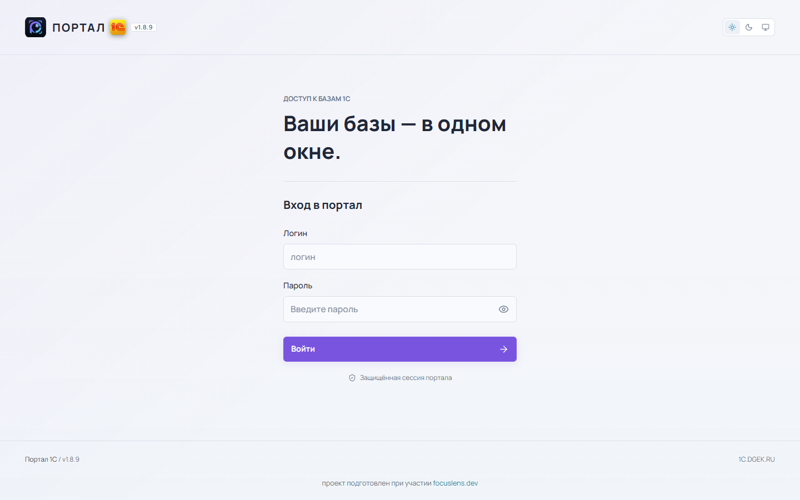
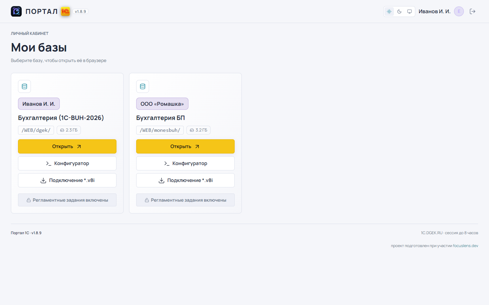
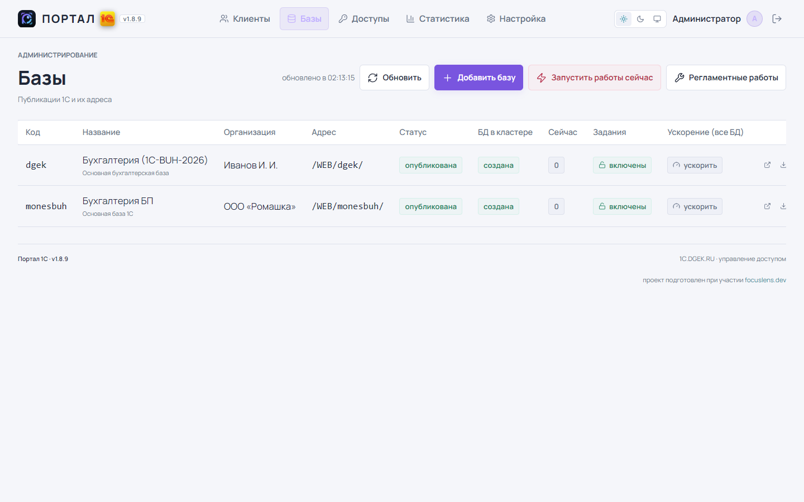

# 1C Small Control

**Версия 1.9.5** · [страница проекта](docs/index.html)

**Веб-портал доступа к базам 1С:Предприятие** — один вход для клиентов, выбор базы, отдельная админ-панель для управления клиентами, базами и правами доступа.

Портал не заменяет 1С и не хранит данные учёта: он работает как «парадная» — показывает пользователю только те информационные базы, к которым ему выдан доступ, и ведёт журнал действий. Сами базы остаются в кластере 1С, доступ — через штатные публикации Apache или через клиент 1С.

---

## Возможности

### Для клиента

- Вход по логину и паролю портала; сессия только по HTTPS.
- Список только своих баз: название, организация, адрес публикации, **размер базы**.
- Кнопка **«Открыть»** — веб-клиент 1С в новой вкладке.
- Кнопка **«Конфигуратор»** — пошаговая инструкция по Конфигуратору и обновлению.
- Кнопка **«Подключение *.v8i»** — файл подключения для тонкого клиента/Конфигуратора.
- Переключатель **«Регламентные задания»** — блокировка фоновых заданий своей базы.
- Плашка о регламентных работах с обратным отсчётом.
- Адаптивная вёрстка, светлая и тёмная тема.

### Для администратора

- **Клиенты**: создание, редактирование, смена пароля, блокировка, удаление.
- **Базы**: добавление с **автоматическим созданием пустой базы в кластере 1С** (роль и БД PostgreSQL, инфобаза, публикация), редактирование, перепубликация, скрытие, удаление.
- **Доступы**: матрица «клиент × база» с организациями под названиями баз.
- **Статистика**: сеансы, время в системе, входы по клиентам и базам, IP, типы клиентов 1С, метрики сервера и лицензий.
- **Отключение сеансов** базы (через `rac`) и блокировка регламентных заданий.
- **Регламентные работы**: запуск сейчас, расписание, предупреждение клиентам, отключение сеансов по таймеру.
- **Архивация баз**: время запуска, число хранимых копий, локальный или SMB-каталог, свободное место, запуск вручную.
- **Настройка**: хост 1С, параметры PostgreSQL, имя портала, расписание перезапуска, перезагрузка сервера, уведомления в Mattermost.
- Журнал действий (`audit`): кто, что и когда сделал.

### Технически

- Пароли — PBKDF2 (Werkzeug); счётчик неудачных входов и блокировка.
- **Защита от подбора**: 5 неудачных попыток → блокировка на 15 минут + сообщение в Mattermost.
- Сессии — подписанная cookie с `Secure`, `HttpOnly`, `SameSite=Lax`; срок 8 часов.
- CSRF-токен во всех формах; разграничение ролей на уровне маршрутов.
- Одна зависимость — Flask; база портала — SQLite (WAL).
- Служебные операции — через bash-скрипты с именными правилами `sudoers`.
- Резервное копирование баз 1С по расписанию с ротацией копий.

---

## Контур доступа

Публикации 1С (`/WEB/<база>/`) снаружи **недоступны напрямую**:

1. Модуль `1cws` слушает публикации на `127.0.0.1:8081` — только изнутри сервера.
2. Запросы к `/WEB/...` с порта 80 проксируются в портал (`ProxyPass /WEB/ http://127.0.0.1:8080/WEB/`).
3. Портал проверяет сессию и право пользователя именно на эту базу.
4. Нет входа → редирект на `/login?next=...`; нет доступа к базе → `403` со страницей-объяснением.
5. Только после проверки портал сам обращается к 1CWS на `127.0.0.1:8081` и передаёт ответ потоком.

Поэтому прямой адрес вида `http://<сервер>/WEB/<база>/ru/` без входа в портал ничего не откроет.

## Скриншоты

Светлая тема, демонстрационные данные.







Тёмная тема и мобильный вид: [docs/screenshots](docs/screenshots).

---

## Стек

| Слой | Технологии |
|---|---|
| Бэкенд | **Python 3.12**, **Flask 3**, Jinja2 |
| БД портала | **SQLite** (WAL, файл `portal.db`) |
| БД 1С | **PostgreSQL Pro 1C 16** |
| WSGI-сервер | **gunicorn** (2 воркера × 32 потока, 127.0.0.1:8080) |
| Веб-сервер | **Apache 2.4** (`mod_proxy`, публикации 1С через `mod_1cws`) |
| Прокси | **nginx** (TLS, HTTP/2, keep-alive) |
| Фронтенд | **HTML5, CSS3, JavaScript (vanilla)** — без сборки и фреймворков |
| Иконки | Lucide (self-hosted, SVG) |
| Шрифт | Manrope (self-hosted, woff2) |
| Сервисы | systemd (юниты и таймеры), bash-скрипты, `ufw`, `fail2ban` |

Внешних CDN нет — всё отдаётся с сервера, портал работает в изолированной сети.

---

## Структура

```
1CSmallControl/
├── app.py                        # приложение: маршруты, схема БД, аутентификация
├── maintenance.py                # регламентные работы: фазы, таймеры, уведомления
├── templates/
│   ├── login.html                # страница входа
│   ├── portal.html               # кабинет клиента
│   ├── admin.html                # админка: клиенты / базы / доступы / статистика / настройка
│   ├── maintenance.html          # заглушка на время работ
│   └── error.html                # страницы 403 / 404 / 500
├── static/
│   ├── app.css                   # базовые стили (дизайн-система)
│   ├── portal.css                # стили портала, масштаб шрифта, адаптив
│   ├── maint.js                  # плашка и обратный отсчёт регламентных работ
│   └── vendor/                   # lucide.js, шрифты Manrope
├── docs/
│   ├── index.html                # презентационная страница проекта
│   ├── screenshots/              # снимки экранов
│   ├── backup.md                 # архивация баз: настройка и устройство
│   ├── security.md               # аудит безопасности и правила секретов
│   ├── proxy-nginx.md            # конфигурация прокси 1c.dgek.ru
│   └── new-server-plan.md        # план переезда на новое железо
├── deploy.sh                     # установка на Ubuntu (пакеты, systemd, Apache)
├── 1c-prepare-base.sh            # создание пустой серверной базы 1С
├── 1c-create-base.sh             # создание базы из портала (роль, БД, инфобаза, публикация)
├── 1c-backup.sh                  # архивация баз по настройкам портала
├── 1c-backup-info.sh             # статус архивации для портала (JSON)
├── 1c-backup-tick.timer/.service # триггер проверки расписания (каждую минуту)
├── 1c-pg-update-mode.sh          # режим ускорения PostgreSQL
├── 1c-jobs-deny.sh               # блокировка регламентных заданий
├── 1c-kick-sessions.sh           # завершение сеансов базы
├── 1c-republish-base.sh          # перепубликация базы
├── 1c-set-cluster-host.sh        # адрес кластера в публикациях
└── .githooks/pre-commit          # защита от коммита с паролем или токеном
```

---

## Установка

Ubuntu 22.04 / 24.04:

```bash
git clone <repo> 1CSmallControl
cd 1CSmallControl
sudo PORTAL_SERVER_NAME=portal.example.ru \
     PORTAL_ADMIN_PASSWORD='<надёжный пароль>' \
     ./deploy.sh
```

Скрипт поставит `python3-flask` и `gunicorn`, разложит файлы в `/opt/1c-portal`, создаст БД, заведёт службу `1c-portal.service` и сайт Apache с проксированием на 8080.

Проверка:

```bash
systemctl status 1c-portal
curl -I http://127.0.0.1:8080/login
```

### Переменные окружения

| Переменная | Назначение | По умолчанию |
|---|---|---|
| `PORTAL_DB` | путь к SQLite | `/opt/1c-portal/portal.db` |
| `PORTAL_SECRET_KEY_FILE` | файл с секретом сессий | `.secret_key` рядом с `app.py` |
| `PORTAL_ADMIN_PASSWORD` | пароль администратора при первой инициализации | генерируется и печатается в лог |
| `PORTAL_SEED_DEMO` | `1` — создать демо-клиентов и демо-базу | выключено |
| `PORTAL_IC_HOST` | сервер 1С в инструкции по Конфигуратору | `1c.example.ru` |
| `PORTAL_VERSION` | версия портала в шапке и подвале | `1.9.2` |
| `PORTAL_MM_LOGIN_HOOK` | хук Mattermost по умолчанию (можно задать в настройках) | не задан |
| `PORTAL_SUPPORT_NAME` | название в блоке «Нужна помощь с платформой?» | `example.ru` |
| `PORTAL_SUPPORT_URL` | ссылка на контакты сопровождения | `https://example.ru/contacts.html` |

### Публикация баз 1С

Портал ссылается на адреса вида `/WEB/<slug>/`, которые отдаёт модуль `1cws` Apache:

```bash
sudo IC_HOST=1c.example.ru ./republish-web.sh dgek buh2
```

Скрипт вызывает `webinst` и создаёт конфиг Apache для каждой базы. Прокси в портале настроен так, чтобы `/WEB/` не перехватывался — иначе 1С-публикация не откроется.

### Создание пустой серверной базы

Из портала: **«Базы» → «Добавить базу»** с включённой галочкой «Создать пустую базу на сервере» — портал создаст роль и БД PostgreSQL, инфобазу в кластере и публикацию.

Вручную:

```bash
sudo IC_HOST=1c.example.ru ./1c-prepare-base.sh buh2026
```

Данные затем загружаются в неё из `.dt` штатным средством Конфигуратора: «Администрирование → Загрузить информационную базу».

### Архивация

Настройка — **«Настройка» → «Архивация баз»**: время запуска (по умолчанию 04:00 МСК), число хранимых копий, каталог (локальный или SMB), логин и пароль SMB. Там же видно свободное место и последние файлы.

Устройство и проверка: [docs/backup.md](docs/backup.md).

### Безопасность

Порты, права, закрытый PostgreSQL, пароль администратора кластера 1С, `fail2ban`, правила хранения секретов — [docs/security.md](docs/security.md).

---

## Вехи

| Дата | Что сделано |
|---|---|
| 2026-02 | Развёрнута серверная часть: Ubuntu 24.04, PostgreSQL Pro 1C 16, кластер 1С 8.3, публикации в Apache |
| 2026-11-04 | Проект портала: вход, кабинет клиента, админка (клиенты, базы, доступы), журнал |
| 2026-11-04 | Дизайн-система из SmallnGinxControl: тёмная тема, Manrope, Lucide |
| 2026-11-04 | Развёртывание на сервере: gunicorn + Apache, служба systemd |
| 2026-11-04 | Организации в карточках, инструкция «Конфигуратор», обновление платформы до 8.3.27.2342 |
| 2026-11-06 | Версия 1.7: регламентные работы, ускорение PostgreSQL, отключение сеансов, статистика и настройка |
| 2026-11-07 | Версия 1.8: создание пустой базы из портала, файл подключения `.v8i`, размер баз, статус «БД в кластере» |
| 2026-11-07 | Оптимизация: HTTP/2 и keep-alive на прокси, потоковая отдача 1С, кэш только статики, 32 потока gunicorn |
| 2026-11-07 | Версия 1.9: firewall `ufw`, закрытый PostgreSQL, пароль администратора кластера 1С, `fail2ban`, защита от подбора с уведомлением в Mattermost, страницы ошибок |
| 2026-11-07 | Версия 1.9.2: архивация баз по расписанию с SMB и ротацией, настройка Mattermost в интерфейсе |

## Известные ограничения

- **Автоматический импорт `.dt` в кластер не реализован**: клиент 1С на Linux в пакетном режиме (`DESIGNER /RestoreIB`) в headless-окружении не запускается. База и публикация создаются порталом, данные загружаются из Конфигуратора.
- Портал не хранит учётные данные 1С: вход в базы — штатными средствами 1С.
- Один экземпляр SQLite — для нескольких серверов нужен переход на PostgreSQL.
- Веб-клиент 1С на слабом процессоре формирует печатные формы медленно: это ограничение сервера 1С, а не портала.

## Лицензия

MIT — см. [LICENSE](LICENSE).

## Участие и поддержка

- [Правила участия](CONTRIBUTING.md) — как сообщить об ошибке, предложить идею и прислать изменения
- [Кодекс поведения](CODE_OF_CONDUCT.md) — нормы общения в проекте
- [Политика безопасности](SECURITY.md) — как приватно сообщить об уязвимости
- [История изменений](CHANGELOG.md) · [Лицензия MIT](LICENSE)
