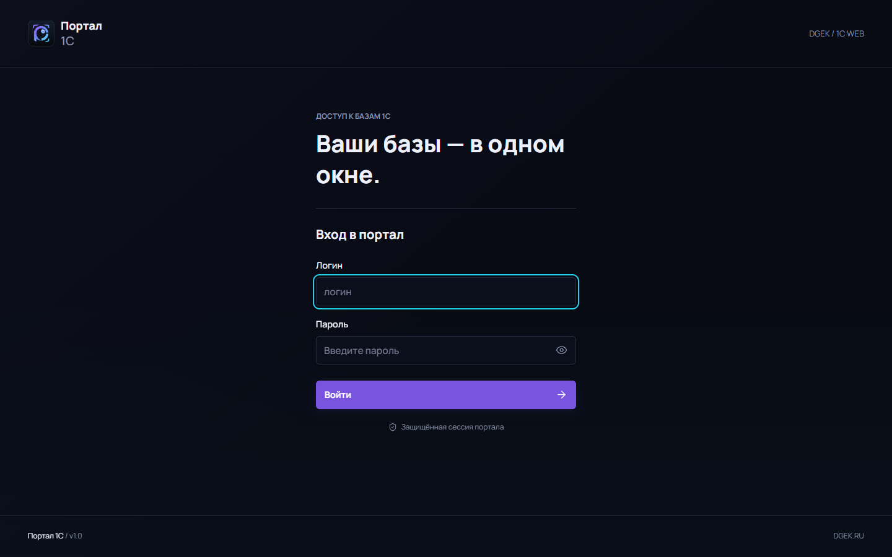
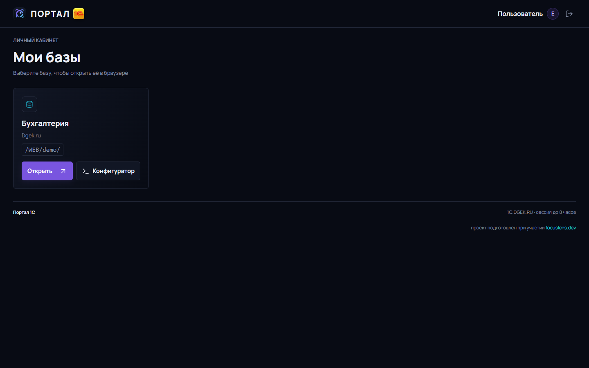
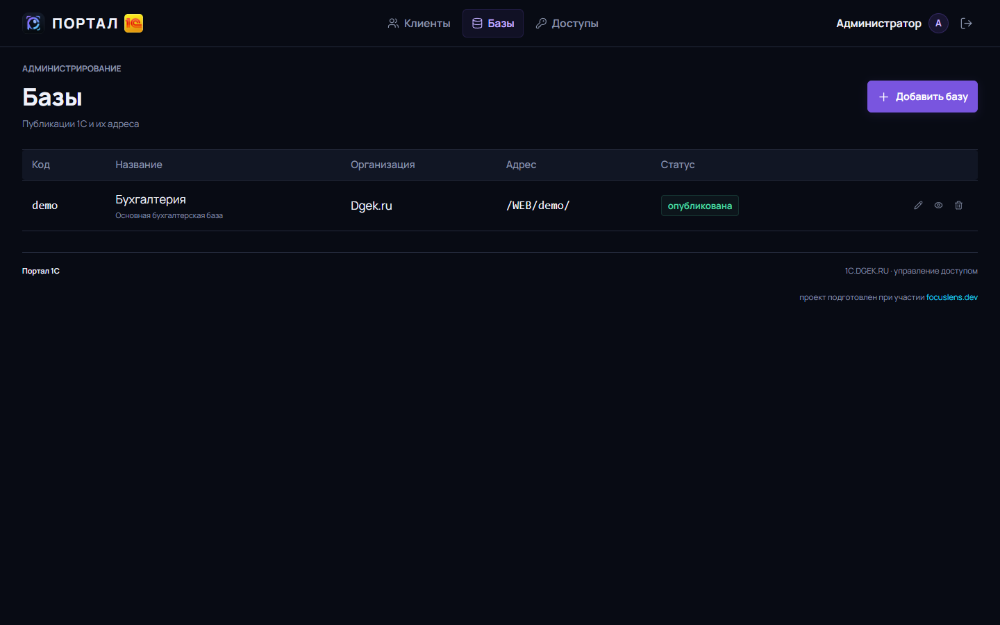

# 1C Small Control

**Версия 1.7** · [страница проекта](docs/index.html)

**Веб-портал доступа к базам 1С:Предприятие** — один вход для клиентов, выбор базы, отдельная админ-панель для управления клиентами, базами и правами доступа.

Портал не заменяет 1С и не хранит данные учёта: он работает как «парадная» — показывает пользователю только те информационные базы, к которым ему выдан доступ, и ведёт журнал действий. Сами базы остаются в кластере 1С, доступ — через штатные публикации Apache или через клиент 1С.

---

## Возможности

### Для клиента
- Вход по логину и паролю портала.
- Список только своих баз: название, организация, адрес публикации.
- Кнопка **«Открыть»** — переход в веб-клиент 1С в новой вкладке.
- Кнопка **«Конфигуратор»** — окно с пошаговой инструкцией: как открыть базу в Конфигураторе и как обновить конфигурацию через толстый клиент.
- Адаптивная вёрстка (телефон, планшет, десктоп).

### Для администратора
- **Клиенты**: создание, редактирование ФИО и организации, смена пароля, блокировка, удаление.
- **Базы**: добавление, редактирование (название, организация, описание, адрес публикации), скрытие и удаление.
- **Доступы**: матрица «клиент × база» — галочками.
- **Отключение пользователей от базы**: в разделе «Базы» кнопка завершает все сеансы 1С у выбранной информационной базы (через 
ac), чтобы освободить базу для обновления или обслуживания.
- Журнал действий (`audit`): кто, что и когда сделал.

### Технически
- Пароли — PBKDF2 (Werkzeug), в открытом виде не хранятся.
- Сессии — подписанная cookie, срок 8 часов, секрет в файле `.secret_key` рядом с приложением.
- CSRF-токен во всех формах.
- Разграничение ролей на уровне маршрутов (`admin_required` / `login_required`).
- Одна зависимость — Flask; БД — SQLite (файл), без отдельного сервера.

---

## Контур доступа

Публикации 1С (`/WEB/<база>/`) снаружи **недоступны напрямую**:

1. Модуль `1cws` слушает публикации на `127.0.0.1:8081` — только изнутри сервера.
2. Запросы к `/WEB/...` с порта 80 проксируются в портал (`ProxyPass /WEB/ http://127.0.0.1:8080/WEB/`).
3. Портал проверяет сессию и право пользователя именно на эту базу.
4. Нет входа → редирект на `/login?next=...`; нет доступа к базе → `403`.
5. Только после проверки портал сам обращается к 1CWS на `127.0.0.1:8081` и возвращает ответ браузеру.

Поэтому прямой адрес вида `http://<сервер>/WEB/<база>/ru/` без входа в портал ничего не откроет.

## Скриншоты

| Вход | 
|---|
|  |

| Кабинет | 
|---|
 |

| Базы Админка|
|---|
|  |

Мобильная версия: [03-client-mobile.png](docs/screenshots/03-client-mobile.png)

---

## Стек

| Слой | Технологии |
|---|---|
| Бэкенд | **Python 3.12**, **Flask 3**, Jinja2 |
| БД | **SQLite** (WAL, файл `portal.db`) |
| WSGI-сервер | **gunicorn** (2 воркера, 127.0.0.1:8080) |
| Веб-сервер | **Apache 2.4** (`mod_proxy`, публикации 1С через `mod_1cws`) |
| Фронтенд | **HTML5, CSS3, JavaScript (vanilla)** — без сборки и фреймворков |
| Иконки | Lucide (self-hosted, SVG) |
| Шрифт | Manrope (self-hosted, woff2) |
| Сервисы | systemd, bash-скрипты развёртывания и публикации |

Внешних CDN нет — всё отдаётся с сервера, портал работает в изолированной сети.

---

## Структура

```
1CSmallControl/
├── app.py                  # приложение: маршруты, схема БД, аутентификация
├── templates/
│   ├── login.html          # страница входа
│   ├── portal.html         # кабинет клиента + модальное окно «Конфигуратор»
│   └── admin.html          # админка: клиенты / базы / доступы
├── static/
│   ├── app.css             # базовые стили (дизайн-система)
│   ├── portal.css          # стили портала, масштаб шрифта, адаптив
│   ├── brand.png
│   └── vendor/             # lucide.js, шрифты Manrope
├── docs/
│   ├── index.html          # презентационная страница проекта
│   └── screenshots/        # снимки экранов
├── deploy.sh               # установка на Ubuntu (пакеты, systemd, Apache)
├── republish-web.sh        # публикация баз 1С под /WEB/<slug>/
├── 1c-prepare-base.sh      # создание пустой серверной базы 1С
└── sudoers-1c-portal       # пример sudoers для скриптов обслуживания
```

---

## Установка

Ubuntu 22.04 / 24.04:

```bash
git clone <repo> 1CSmallControl
cd 1CSmallControl
sudo PORTAL_SERVER_NAME=portal.example.ru \
     PORTAL_ADMIN_PASSWORD='<надёжный пароль>' \
     ./deploy.sh
```

Скрипт поставит `python3-flask` и `gunicorn`, разложит файлы в `/opt/1c-portal`, создаст БД, заведёт службу `1c-portal.service` и сайт Apache с проксированием на 8080.

Проверка:

```bash
systemctl status 1c-portal
curl -I http://127.0.0.1:8080/login
```

### Переменные окружения

| Переменная | Назначение | По умолчанию |
|---|---|---|
| `PORTAL_DB` | путь к SQLite | `/opt/1c-portal/portal.db` |
| `PORTAL_SECRET_KEY_FILE` | файл с секретом сессий | `.secret_key` рядом с `app.py` |
| `PORTAL_ADMIN_PASSWORD` | пароль администратора при первой инициализации | генерируется и печатается в лог |
| `PORTAL_SEED_DEMO` | `1` — создать демо-клиентов и демо-базу | выключено |
| `PORTAL_IC_HOST` | сервер 1С в инструкции по Конфигуратору | `1c.example.ru` |
| `PORTAL_VERSION` | версия портала в шапке и подвале | `1.0` |
| `PORTAL_SUPPORT_NAME` | название в блоке «Нужна помощь с платформой?» | `example.ru` |
| `PORTAL_SUPPORT_URL` | ссылка на контакты сопровождения | `https://example.ru/contacts.html` |

### Публикация баз 1С

Портал ссылается на адреса вида `/WEB/<slug>/`, которые отдаёт модуль `1cws` Apache:

```bash
sudo IC_HOST=1c.example.ru ./republish-web.sh dgek buh2
```

Скрипт вызывает `webinst` и создаёт конфиг Apache для каждой базы. Прокси в портале настроен так, чтобы `/WEB/` не перехватывался — иначе 1С-публикация не откроется.

### Создание пустой серверной базы

Если нужно развернуть новую базу в кластере 1С (роль PostgreSQL + инфобаза + публикация):

```bash
sudo IC_HOST=1c.example.ru ./1c-prepare-base.sh buh2026
```

Данные затем загружаются в неё из `.dt` штатным средством Конфигуратора: «Администрирование → Загрузить информационную базу».

---

## Вехи

| Дата | Что сделано |
|---|---|
| 2026-02 | Развёрнута серверная часть: Ubuntu 24.04, PostgreSQL Pro 1C 16, кластер 1С 8.3, публикации в Apache |
| 2026-11-04 | Проект портала: вход, кабинет клиента, админка (клиенты, базы, доступы), журнал |
| 2026-11-04 | Дизайн-система перенесена из SmallnGinxControl: тёмная тема, Manrope, Lucide |
| 2026-11-04 | Развёртывание на сервере: gunicorn + Apache, служба systemd, редиректы `/dgek/` → `/WEB/dgek/` |
| 2026-11-04 | Масштабирование интерфейса: текст и таблицы увеличены, читаемость на 1440px |
| 2026-11-04 | Организации в карточках клиентов и баз, редактирование ФИО и организации |
| 2026-11-04 | Инструкция «Конфигуратор и обновление 1С» в кабинете клиента (модальное окно) |
| 2026-11-04 | Обновление платформы 1С на сервере до 8.3.27.2342 (сервер, модуль веб-сервера, ras) |
| 2026-11-04 | Публикация проекта: README, страница `docs/index.html`, скриншоты |

## Известные ограничения

- **Автоматический импорт `.dt` в кластер не реализован**: клиент 1С на Linux в пакетном режиме (`DESIGNER /RestoreIB`) на тестовом стенде не запускается в headless-окружении. База создаётся скриптом `1c-prepare-base.sh`, данные загружаются из Конфигуратора.
- Портал не хранит учётные данные 1С: вход в базы — штатными средствами 1С.
- Один экземпляр SQLite — для нескольких серверов нужен переход на PostgreSQL.

## Лицензия

MIT — см. [LICENSE](LICENSE).

## Участие и поддержка

- [Правила участия](CONTRIBUTING.md) — как сообщить об ошибке, предложить идею и прислать изменения
- [Кодекс поведения](CODE_OF_CONDUCT.md) — нормы общения в проекте
- [Политика безопасности](SECURITY.md) — как приватно сообщить об уязвимости
- [История изменений](CHANGELOG.md) · [Лицензия MIT](LICENSE)
